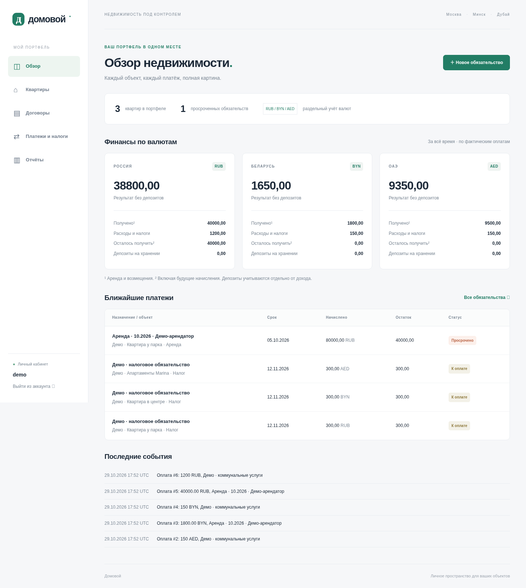

# Домовой — управление арендной недвижимостью

Рабочая первая версия личного сайта для квартир в Москве, Минске и Дубае. Русский интерфейс адаптирован для компьютера и телефона.

## Возможности

- Закрытый кабинет владельца. Данные разных учётных записей изолированы.
- Квартиры, арендаторы и договоры с датами, арендой, депозитом и условиями.
- Редактирование сведений и договоров; существующие финансовые суммы не переписываются.
- Начисление аренды за выбранный месяц. Неполный месяц рассчитывается по календарным дням; повторный запуск не создаёт дубликатов. День оплаты 29–31 ограничивается последним днём месяца.
- Отдельные обязательства для аренды, возмещений коммуналки, расходов владельца, налогов, получения и возврата депозита.
- Частичные оплаты, остатки и просрочки с учётом часового пояса квартиры. Повторная отправка одной формы оплаты безопасна.
- Отмена ошибок с причиной и сохранением записей. Получение депозита нельзя отменить, пока связанные возвраты делают остаток недостаточным.
- Обзор и кассовые отчёты отдельно в RUB, BYN и AED. Депозиты не увеличивают арендный доход.
- Фильтры по квартире, городу, категории и статусу; выгрузка реестра обязательств в CSV.
- Закрытые PDF/JPG/PNG-документы у обязательств, до 10 МБ. Скачивание проверяет владельца.
- Демонстрационные данные и резервное копирование SQLite вместе с документами.



Данные сохраняются в SQLite и каталоге `media/`; это личная версия для небольшой нагрузки. Концепция полного продукта: [docs/CONCEPT.md](docs/CONCEPT.md).

## Запуск разработки

Требуется Python 3.12. Команды выполняются из корня репозитория:

```bash
bash scripts/setup.sh
.venv/bin/python manage.py createsuperuser
bash scripts/start.sh
```

Сервер слушает loopback на порту 8000. Вход — `/login/`. Публичной регистрации и паролей по умолчанию нет. Пароль вводится в терминале интерактивно; не записывайте его в Git или командную строку.

Необязательный пример с тремя квартирами в отдельном аккаунте:

```bash
.venv/bin/python manage.py seed_demo
.venv/bin/python manage.py changepassword demo
```

`seed_demo` создаёт только синтетические записи и аккаунт без пригодного для входа пароля. Повторный запуск не дублирует данные. Для реальных объектов используйте собственную учётную запись.

## Как начать учёт

1. Добавьте квартиру и её валюту. После появления договоров или расчётов валюта защищена от изменения.
2. Создайте договор: арендатор, сроки, аренда, день оплаты, согласованный депозит.
3. На странице договоров выберите первое число месяца и начислите аренду.
4. Откройте обязательство и зарегистрируйте фактическую оплату. Частичная оплата оставляет долг.
5. Добавьте коммунальный расход или налог как отдельное обязательство. Для возмещения арендатором создайте отдельную запись категории «Возмещение коммунальных расходов».
6. Получение и возврат депозита регистрируйте отдельно, с привязкой к договору. Согласованная сумма в договоре сама по себе не означает получения денег.
7. Сверьте кассовый отчёт за выбранные даты. CSV выгружает реестр обязательств с текущими остатками, а не банковскую выписку за период отчёта.

Сумма оплаты не должна превышать остаток обязательства. Авансы и оплата сразу нескольких обязательств в этой версии не поддерживаются: распределите фактически полученную сумму между отдельными обязательствами. Обмен валют не выполняется; операции регистрируются в валюте квартиры.

Ставка договора действует при создании начисления. Для изменения ставки только с будущей даты сначала начислите предшествующие месяцы по старым условиям. Версионирование условий по датам пока не реализовано. Закрытие договора выполняется изменением даты окончания; уже созданные будущие начисления при необходимости отменяются вручную с причиной.

## Проверки

```bash
.venv/bin/python manage.py test
.venv/bin/python manage.py makemigrations --check --dry-run
.venv/bin/python manage.py check
```

Тесты проверяют расчёты, частичные оплаты, защиту от переплаты и повторной отправки, депозиты и возвраты, отмены, повторные начисления, неполные месяцы, разные валюты, изоляцию владельцев, документы, CSRF и страницы приложения.

Дополнительная проверка стиля (Ruff не является зависимостью запуска):

```bash
ruff check config portfolio manage.py
ruff format --check config portfolio manage.py
```

## Резервная копия и восстановление

Перед резервным копированием остановите сервер, чтобы база и загруженные файлы соответствовали одному состоянию. ZIP содержит персональные и финансовые данные: храните его вне Git, на защищённом носителе. Файл создаётся с правами `0600`; существующий архив не перезаписывается.

```bash
.venv/bin/python manage.py backup /workspace/backups/estate-2026-10-29.zip
```

Для восстановления остановите приложение, сохраните текущие `db.sqlite3` и `media/`, затем извлеките **собственный доверенный** архив в отдельную пустую директорию и перенесите `db.sqlite3` и `media/` в корень приложения. Запустите `migrate`, `check` и проверьте вход, суммы и скачивание документов. Если ранее использовалась иная версия приложения, сначала восстановите соответствующую версию кода. `.local-secret` не включён в архив: новый ключ завершит прежние сессии; пароли пользователей остаются в базе в виде хешей.

## Конфигурация и размещение

| Переменная | Назначение |
| --- | --- |
| `DJANGO_DEBUG` | `1` для разработки; `0` для публичного размещения |
| `DJANGO_SECRET_KEY` | Обязательный случайный секрет при `DEBUG=0`; передаётся через защищённую конфигурацию |
| `DJANGO_ALLOWED_HOSTS` | Имена хостов через запятую, без схемы |
| `DJANGO_CSRF_TRUSTED_ORIGINS` | Доверенные HTTPS origins через запятую, если нужны |
| `DATABASE_PATH` | Путь к SQLite, по умолчанию `db.sqlite3` в корне |
| `ESTATE_BIND` | Адрес development-сервера; по умолчанию `127.0.0.1:8000` |

Без переменной `DJANGO_SECRET_KEY` в режиме разработки создаётся локальный файл `.local-secret` с правами `0600`, исключённый из Git. При `DEBUG=0` приложение без явного ключа откажется запускаться, включает HTTPS redirect, защищённые cookie и HSTS.

`runserver` предназначен для разработки. Публичное размещение требует WSGI-сервера, HTTPS reverse proxy, обслуживания `staticfiles/` после `collectstatic`, постоянного защищённого хранилища базы/документов, резервных копий и ограничения попыток входа на reverse proxy. Каталог `media/` нельзя публиковать как статические файлы: документы выдаёт только авторизованное представление. Доверие proxy headers настраивается отдельно под конкретный сервер. Публичное размещение в этой задаче не выполнялось.

## Что ещё предстоит

Банковские интеграции, автоматические налоговые ставки, курсы валют, авансы и распределение одного платежа, связанные цепочки возмещений, индексация и версии договоров, счётчики, автоматические напоминания, кабинеты арендатора/бухгалтера, второй фактор, закрытие периодов и переход на PostgreSQL — дальнейшие этапы из концепции. Текущий налоговый раздел хранит введённые владельцем суммы и сроки, а не рассчитывает применимый налоговый режим.
